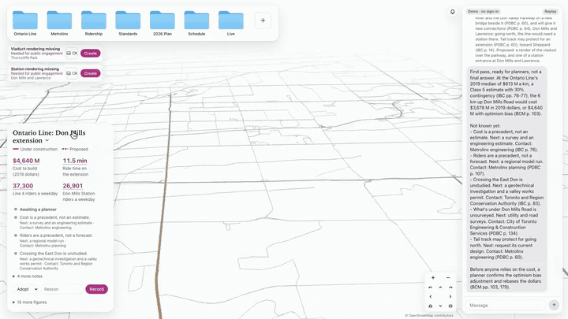
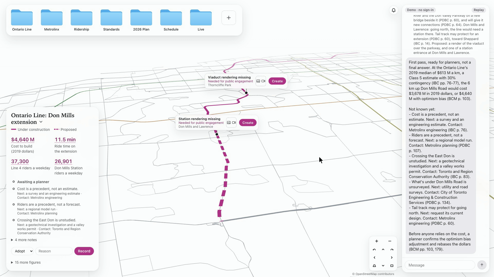
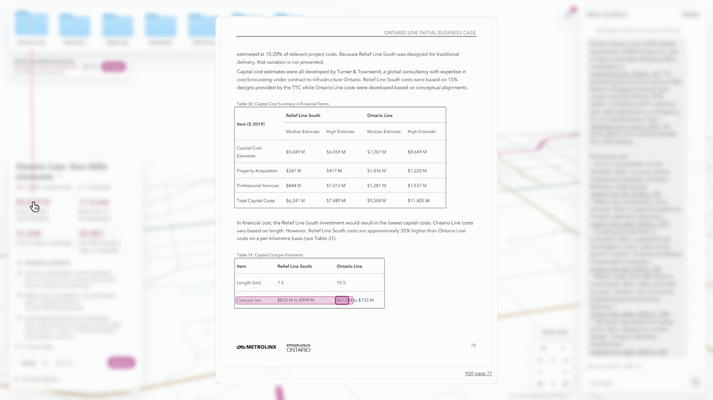
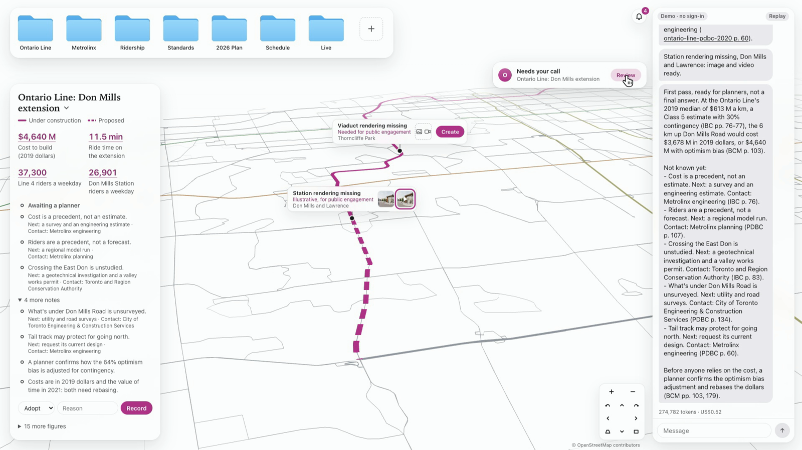

# Transit Agents

A service where AI agents do the first pass of transit planning studies. Every
number traces to the page it came from, and planners make every decision.



[Watch it as a video](docs/media/demo.mp4). Recorded from the running display.

| | |
|---|---|
|  |  |
| The study on the map: figures, what isn't known yet, and the lead's first pass. | Every figure opens to its source page, highlighted. |



## What it does

- **Agents and skills:** a lead agent splits each request among specialists,
  each working with a skill: the TTC's service standards, Metrolinx business
  cases and benefit-cost analysis, schedules, trial monitoring, consultation,
  cost benchmarks and more. They read the sources, record figures with their
  pages, and hand every judgement to a planner. Catalogue: [docs/agents.md](docs/agents.md).
- **Studies:** an Ontario Line extension north up Don Mills, built from the
  line's business cases, TTC counts and Metrolinx's appraisal rules; and two
  proposals from the TTC's 2026 Annual Network Plan, Lawrence–Sunnybrook and
  Sherbourne–Castle Frank.
- **Service:** an append-only log of every figure, check, finding and decision,
  with an API, webhooks and a watched folder.
- **Live trial:** a collector measures Lawrence–Sunnybrook's reliability from
  the public TTC feed through its 12-month trial, from November 1, 2026.
- **Display:** the study, its map and the chat. Lighthouse 100 for
  accessibility, best practices and SEO.
- **Computer use:** agents work legacy desktop tools by sight, a trip scheduler
  and a traffic microsimulator, included as sample apps.
- **Evals:** 145 cases, at least 8 for each skill. See [docs/evals.md](docs/evals.md).

## Run it

Needs Node 24 or later, and Python 3.11 or later for the agents. Poppler
(`pdftotext`) is optional, for uploaded PDFs.

```sh
npm install
npm run build              # build the display
npm run collect            # in its own terminal: record live vehicles
npm run demo -- --fresh    # start the service and load the public sources
npm run replay             # play the scripted agent run, which needs no model
npm run decide             # a planner rates consultation and records decisions
npm run agent              # in its own terminal: Gemini answers the chat
```

For the agents, make `agents/.venv` with `agents/requirements.txt` installed,
and put `GEMINI_API_KEY` in `agents/.env`. If the demo runs with `DATA_DIR` or
`PORT` set, give the agent the same `DATA_DIR` and its `TRANSIT_URL`: the demo
prints the commands. A message sent while no agent runs gets no answer. To have
Gemini do a study's first pass instead of the replay:
`npm run agent -- run "<what to find>" --study <id>`. Agent runs stop at 60
model calls or US$2 each, and a listening agent at US$10 a day and 20 runs an
hour (see `agents/main.py` for the settings).

Open http://127.0.0.1:4100. The demo switches on open access, so this machine
acts as a planner. Never use open access on a shared network. Chrome can install
the display as an app, Transit Agents, from the address bar.

On studies with a trial, Space plays time; the speed button steps from real time
to a week a second. Other studies show the present. Vehicles are live at the
present moment, and scheduled otherwise until the published timetable ends.

Cards on the map are what a neighbourhood needs to hear about a change. A
planner or a visitor presses Create, an agent makes the image or video, and the
card shows it; click it to view it.

Decisions made on this display carry the name in `PLANNER_NAME`, set in
`agents/.env` (`PLANNER_NAME=Ana Ruiz`); without it, they say "local".

For a second screen, http://127.0.0.1:4100/spend shows what the agents have
spent, for visitors too: dollars, tokens, model calls, and at least the energy
those calls used, with its CO2e. Use the browser's full screen.

To hear about the shared record in Slack, set `SLACK_WEBHOOK_URL` to a Slack
incoming webhook (`https://hooks.slack.com/services/...`) and `PUBLIC_URL` to
the display's address. `npm run slack:demo` posts one sample of each notice.
When the lead's answer ends "Executive decision required: ...", the chat offers
a planner a button that pings the executive in that channel. Set
`SLACK_EXECUTIVE="Jordan Lee <U0123ABCD>"`: their name, and their Slack member
ID for an @-mention (in Slack, their profile › ⋮ › Copy member ID). A name
alone is posted in bold, with no mention; unset, it's "@executive".
Both are the service's settings, so set them in the shell that runs `npm run
dev` (agents/.env doesn't reach the service), or with `fly secrets set` on Fly.
See [Slack](docs/system.md#slack).

Checks: `npm test` (535 tests), `npm run typecheck`, and `npm run agent:test`
(336 Python tests, which never call Gemini; set `AGENT_TEST_PORT` and
`EVAL_PORTS` if ports 4171-4174 or 4175-4179 are taken).

## Plug in your agents

Agents call the same API as every other client. Schema: `GET /openapi.json`.
Routes and roles: [docs/system.md](docs/system.md). Planner-only calls return
403 to agents.

Start the service with one token per role:

```sh
TRANSIT_TOKENS=agent:lead:SECRET1,planner:ana:SECRET2,integration:hastus:SECRET3 npm run serve
```

An agent's working loop:

```sh
# Open a study
curl -X POST localhost:4100/v1/studies -H 'authorization: Bearer SECRET1' \
  -H 'content-type: application/json' -d '{"id":"my-study","title":"My study"}'

# Report activity and spend
curl -X POST localhost:4100/v1/studies/my-study/activity -H 'authorization: Bearer SECRET1' \
  -H 'content-type: application/json' \
  -d '{"kind":"usage","model":"gemini-3.8-flash","inputTokens":1200,"outputTokens":300,"costUsd":0.01}'

# Add a figure: rejected unless the quote is on that page and contains the value
curl -X POST localhost:4100/v1/studies/my-study/figures -H 'authorization: Bearer SECRET1' \
  -H 'content-type: application/json' \
  -d '{"id":"riders","label":"Riders","value":1680,"basis":{"kind":"cited","citation":{"contextId":"ttc-anp-2026","page":118,"quote":"weekly system ridership increase of 1,680 customers"}}}'

# Hear about everything, live
curl -N 'localhost:4100/v1/events?access_token=SECRET1'
```

Python agents can connect over MCP instead, at `/v1/mcp`. Every route except
the event stream, webhook subscriptions, guest passes, and file uploads and
downloads is a tool, and an agent sees only the tools its role may call. A
video is larger than an MCP message may be, so an agent posts media to
`POST /v1/studies/{id}/needs/{need}/media` as a form, with its token. With `pip install mcp google-genai`
(mcp 2.3, google-genai 3.0), and `TRANSIT_TOKEN_AGENT` and `GEMINI_API_KEY` set:

```python
import asyncio
import os

import httpx2
from google import genai
from google.genai import types
from mcp import ClientSession
from mcp.client.streamable_http import streamable_http_client

MODEL = "gemini-3.8-flash"
STUDY = "route-52"


async def main():
    token = os.environ["TRANSIT_TOKEN_AGENT"]
    async with (
        httpx2.AsyncClient(headers={"authorization": f"Bearer {token}"}) as http,
        streamable_http_client("http://127.0.0.1:4100/v1/mcp", http_client=http) as (read, write),
        ClientSession(read, write) as session,
        # Hold the client: google-genai closes its connections once it's dropped.
        genai.Client().aio as gemini,
    ):
        server = await session.initialize()
        await session.call_tool("open_study", {"id": STUDY, "title": "Route 52"})
        # A dict, with client.aio.models. A GenerateContentConfig or the chat API
        # copies the config, which fails with a live session, and the sync
        # client refuses MCP sessions. Gemini gets the server's rules as
        # instructions. The tool loop runs here, not in google-genai, so this
        # code can report each model call's tokens: the model can't see them.
        config = {
            "tools": [session],
            "system_instruction": server.instructions,
            "automatic_function_calling": {"disable": True},
        }
        prompt = f"Add route 52's weekly riders to study {STUDY}, with a citation."
        contents = [types.Content(role="user", parts=[types.Part(text=prompt)])]
        for _ in range(30):
            response = await gemini.models.generate_content(model=MODEL, contents=contents, config=config)
            usage = response.usage_metadata
            await session.call_tool("report_activity", {
                "studyId": STUDY, "kind": "usage", "model": MODEL,
                "inputTokens": usage.prompt_token_count or 0,
                # Thinking is billed as output. Add "costUsd" at your model's prices.
                "outputTokens": (usage.candidates_token_count or 0) + (usage.thoughts_token_count or 0),
            })
            if not response.function_calls:
                print(response.text)
                break
            contents.append(response.candidates[0].content)
            parts = []
            for call in response.function_calls:
                result = await session.call_tool(call.name, call.args or {})
                # Each result once: structured when it's an object, else the text.
                answer = result.structured_content or result.content[0].text
                key = "error" if result.is_error else "output"
                parts.append(types.Part.from_function_response(name=call.name, response={key: answer}))
            contents.append(types.Content(role="user", parts=parts))
        else:
            print("Stopped after 30 model calls")


asyncio.run(main())
```

`agents/media.py` is one such agent. Once a planner or a visitor asks for an
engagement need to be made, it renders the transit infrastructure the need names,
at its real site: a station entrance, the elevated guideway, a platform, the line
on its street, or a bus stop with its bus. Gemini 3.6 Flash writes the prompts from
the need's cited pages, Nano Banana 2 makes the still in the clean style of agency
and consultancy renderings, with openly licensed photos of the site for its
terrain, roads and buildings (`agents/sites`), and Omni Flash animates the still
into a short camera move through or along it. Each file records the photos its
still was made with, and the display credits them. Gemini reads each file back, a
video as stills at full size too (taken with ffmpeg, which the agent needs), and it
is made once more if it shows any words, numbers, arrows or pictograms, made-up
lettering included. It claims each request before it spends anything, so two
agents never both pay for one. When it can't make something, it says why, and
nothing more is made until someone asks again. It reports every call's tokens and
cost, priced from one table at the top of the file. At those prices an image costs
about $0.07 and a 4-second video about $0.28, so a need with both is about $0.35
with its prompts. A need for video alone costs the same: its still is made first.
It spends at most $5 a day (`MEDIA_DAILY_LIMIT_USD`), visitors' requests included.
What the service hasn't counted or been given yet waits in `media-journal` in
`DATA_DIR`, so a restart neither loses the spend nor pays for a file twice.

```sh
agents/.venv/bin/python agents/media.py listen  # until stopped
npm run agent:test                              # with a stand-in for Gemini
```

## Computer use

Many agencies still schedule service and time signals in old desktop tools
with no API. `agents/computer_use.py` works one by sight with Gemini's computer
use tool: it sends Gemini 3.8 Flash a screenshot, does the click or keystroke
Gemini picks, and sends the next screenshot, until the task is done. `--app`
picks the app, shown in Chrome for Testing through Playwright:

- `scheduler` (the default): `apps/legacy-mock`, an old-style trip
  scheduler with sample data.
- `microsim`: `apps/microsim-mock`, "Intersection Simulator 4.2", a traffic
  microsimulator for one signalized intersection, Don Mills Rd & Eglinton Ave E,
  with sample volumes and a sample signal plan. It stands in for tools like Vissim or
  Synchro, and copies none of them. It draws the intersection with its lanes,
  left-turn bays and signals, and runs 15 minutes of AM peak with a seeded
  car-following model, so a plan always gives the same results. Its results
  give each movement's delay, longest queue and LOS (HCM thresholds), before and
  after the change.

Each app has its own address, and the agent can't leave it: the browser refuses
every other address, the other app's included, and Gemini isn't offered
navigation.

It needs the agents set up as in Run it, with `GEMINI_API_KEY` in
`agents/.env`, and Node 24 or later. Recording needs ffmpeg. The service needn't
run unless the agent reports to a study.

```sh
npx playwright-core install chromium   # once: Chrome for Testing, or set CHROME_PATH
agents/.venv/bin/python agents/computer_use.py --confirm                   # the default task
agents/.venv/bin/python agents/computer_use.py --confirm --record run.mp4  # and a video of it
agents/.venv/bin/python agents/computer_use.py "<task>" --headed           # another task, in a window
agents/.venv/bin/python agents/computer_use.py --app microsim --confirm --record microsim.mp4  # the microsim
```

In the scheduler, by default it changes route 605 Elm's weekday peak headway
from 8 to 6 minutes and saves. Its routes and headways are sample data. A planner decides the change; the agent only carries it
out.

In the microsim, by default it lengthens phase 2 (NB/SB left) from 12 to 20 s
of green, runs the simulation, and saves if the northbound left's delay drops.
The sample data starts with that left over capacity: its queue spills out of the
bay and blocks a through lane. The run takes about 10 s at 120×, and the
terminal ends with the before and after:

```text
The app saved: SC1 AM peak: phase 2 (NB/SB left) green 12 → 20 s.
Northbound left: 221.3 → 43.9 s/veh, LOS F → D. Intersection: 63.2 → 44.4 s/veh, LOS E → D (Run 1 → Run 2).
```

Gemini's safety filter refused the task when it read as changing a real
intersection's signals, so it says it is an edit to a simulation model with
sample data. Ours took 7 calls, about a minute and US$0.02.

The agent asks, and the planner confirms. In our runs, Gemini's safety check
asked a person to confirm before it pressed OK and Save. Without `--confirm`,
the agent asks at the terminal and stops unless told yes. `--confirm` says yes
in advance, for the planner who set the task. A recording captions that moment
"The agent asks. The planner confirms.", then says who said yes, and when.

A run stops at 15 model calls, or before one likely to take it past US$1.50,
judged by what the last call cost; `--steps` and `--max-usd` set other caps. A
call Gemini didn't answer in time counts as one, at an estimated cost, since
Gemini may have run it. It refuses a model with no price in `agents/prices.py`
or `MODEL_PRICES`, whose calls would count as free. Ours took 8 or 9 calls and
about US$0.02 a run. `--study <id>` reports each call's tokens and cost to that
study, and `--record` writes a 1920x1080 video with a caption for each step,
using ffmpeg. Its tests use a stand-in for Gemini, and skip without Chrome for
Testing.

## Repo

- `services/api`: the service and the collector (`collect.ts`)
- `apps/display`: the display, Preact with a WebGL map in a worker
- `apps/legacy-mock`: a legacy-style trip scheduler, for computer use
- `apps/microsim-mock`: a traffic microsimulator, for computer use
- `packages/contracts`: types and schemas shared by every client
- `agents`: the Gemini lead and specialists, their skills, the media and computer-use agents, and the eval runner
- `clients`: seed, replay and decide, via the public API
- `evals`: eval cases, inputs and scorer
- `scripts`: data pipelines from GTFS and the plan PDFs
- `docs`: [system and API](docs/system.md),
  [decisions, made and open](docs/decisions.md),
  [what agents should do](docs/queries.md), [eval set](docs/evals.md),
  [PNNL-style benchmark](docs/benchmark.md), [skills to build](docs/skills.md),
  [fast rollout](docs/rollout.md), [corrections to the report](docs/report-corrections.md)

## Data

TTC schedules and live positions come from the City of Toronto's
[Open Data portal](https://open.toronto.ca/), under the Open Government
Licence – Toronto. Plan, standards and ridership pages are from public TTC
documents, and business case pages from public Metrolinx documents, included
as text and page images for checking citations. The Ontario Line and its
proposed extension are drawn from [OpenStreetMap](https://www.openstreetmap.org/copyright),
© OpenStreetMap contributors, under the Open Database License.
