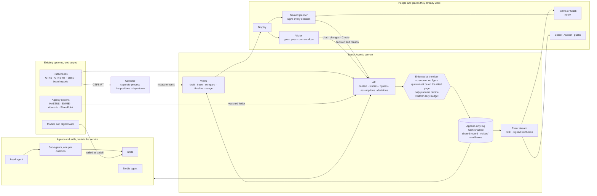

# System

How the service fits together: its parts, rules, API and roles. Agents,
planners, existing agency systems and the display are all clients of it.

## Rules

1. **The log is the only source of truth.** Every write is one log entry.
   Drafts, dashboards, webhooks and the display all read from it, so they can't
   disagree with it.
2. **The API, not prompts, enforces guarantees.** A figure with no source is
   rejected. So is a cited figure whose quote isn't on the cited page, whose
   value isn't in the quote, or whose sign contradicts the wording. Only
   documents added by planners or agency systems can be cited.
3. **People decide.** Agents draft and check. Planners set the rules checks use,
   rate how consultation reads, accept skill results and record decisions.
   Deciding against a clear analysis is recorded as an override, with a reason.
4. **Existing systems stay.** Data arrives as exports they already produce, and
   decisions leave as webhooks. Nothing is migrated.
5. **Two clocks, never mixed.** The log always uses real time. The display's
   time control is a view of schedules and forecasts, and writes nothing.
6. **Measured and forecast stay apart.** A separate collector measures live
   data. Forecasts are published claims, shown as flat rates, never added up.
7. **Content can be removed; history can't.** Entry content sits outside the
   hash chain, so it can be removed for retention or privacy while the chain
   still verifies and shows that something was there.
8. **Generated media is illustrative, and made only when a person asks.**
   Agents propose what a neighbourhood needs to hear about a change, and what
   its render shows: a station entrance, the guideway, a platform, the line on
   its street, or a bus stop with its bus. Images and videos are kept by their
   hash outside the log, which records the hash, the model, the prompt and what
   it drew on, and they are always labelled Illustrative.
9. **Skills run only as a planner approved them.** A skill's version is the
   SHA-256 of its folder, every file's path and bytes. Each skill has one current
   version, the one a planner approved last. Agents load a skill only while its
   folder hashes to it, and a computed figure must name it. The agent names it, never the
   skill's script. Each call to a script runs in a new process with no keys or
   tokens; the agent makes its calls to the service, and only those its
   specialist may make. On macOS, sandbox-exec also keeps it off the network and
   away from the data folder, the eval cases, `.env` files and other skills.

## API

Full schema at `GET /openapi.json`.

- Add context: `POST /v1/context`, or drop a file in the watched folder
- Search source pages: `GET /v1/search`
- Open a study: `POST /v1/studies`
- Report agent activity, tokens and cost: `POST /v1/studies/{id}/activity`
- Add a figure: `POST /v1/studies/{id}/figures`
- Test a figure against a rule: `POST /v1/studies/{id}/checks`
- Add a finding, such as consultation: `POST /v1/studies/{id}/findings`
- Rate how a finding reads: `PUT /v1/studies/{id}/findings/{finding}/tone`
- Approve a skill version, its folder's SHA-256, as the skill's current one,
  replacing the one before (planners only): `PUT /v1/skills/{name}`, or
  `npm run approve-skill -- <name> [<hash>]` after review. With the hash, it
  approves only if the folder still has it. Rolling back is approving the parent's
  hash again. The demo's seed approves the skills on disk
- Withdraw a skill's current version, so no agent loads it (planners only):
  `POST /v1/skills/{name}/revoke`, or `npm run approve-skill -- --revoke <name> <reason>`
- Each skill's current version: `GET /v1/skills`
- Put a skill version forward for a planner to approve, once it has passed its gate (agents only): `POST /v1/skills/{name}/candidates`. It approves nothing
- Accept a skill's result: `POST /v1/studies/{id}/figures/{figure}/accept`
- Set or change a rule or assumption: `PUT /v1/assumptions/{key}`
- Try a change without recording it: `POST /v1/studies/{id}/preview`
- Record a decision: `POST /v1/studies/{id}/decisions`
- Ping the executive on Slack about an answer's executive decision (planners only): `POST /v1/studies/{id}/escalate`
- Propose something to make for public engagement: `POST /v1/studies/{id}/needs`
- Ask for it to be made: `POST /v1/studies/{id}/needs/{need}/create`
- Take a request on before spending anything (agents only): `POST /v1/studies/{id}/needs/{need}/claim`
- Say why it couldn't be made, with the claim: `POST /v1/studies/{id}/needs/{need}/failed`
- Attach a generated image or video, as a form (agents only): `POST /v1/studies/{id}/needs/{need}/media`
- Take a file down: `POST /v1/studies/{id}/needs/{need}/media/{media}/withdraw`
- Drop a need nobody has to make any more: `POST /v1/studies/{id}/needs/{need}/dismiss`
- Read an image or video, with no token, in every mode, since an image tag can't
  send one: `GET /v1/media/{id}`. Anyone who has a file's URL can see it, so
  treat generated media as public. A planner can take one down.
- Read a study: `GET /v1/studies/{id}`
- Trace a figure to its source: `GET /v1/studies/{id}/figures/{figure}/trace`
- What changed between versions: `GET /v1/studies/{id}/compare`
- Results over time: `GET /v1/studies/{id}/timeline`
- Read or verify the log: `GET /v1/log`, `GET /v1/log/verify`, `GET /v1/log/head`
- Remove an entry's content: `POST /v1/log/{seq}/remove-content`, with the
  visitor's `audience` for an entry in their sandbox
- Live vehicles: `GET /v1/live/vehicles`
- Tokens and cost: `GET /v1/usage`. Everything agents have spent, visitors'
  sandboxes included in the total, so the spend screen shows it all; the same
  for everyone. By study, it counts the shared record only.
  Each total also has at least the energy, CO2e and water its model calls used,
  each call counted as Google's median Gemini prompt
  ([paper](https://arxiv.org/abs/2508.15734)).
- Stream everything live: `GET /v1/events`. A model call made in a sandbox you
  can't read comes as an empty `usage` event, so the spend screen updates at once
- Be told about decisions: `POST /v1/subscriptions`
- Connect an agent over MCP: `/v1/mcp`
- Get a guest pass: `POST /v1/guests`
- What is left of visitors' budget today: `GET /v1/budget`

## Who may do what

Every request needs a token, unless demo mode (anyone reads) or open access (a
local demo) is switched on. Under open access a request without a token acts as
a planner, but is answered only at an IP address, localhost or `PUBLIC_URL`'s
name: a page that reaches the service under another name, after DNS rebinding,
gets nothing. Writes come only from the service's own pages (see below). Bodies
are JSON, sent as JSON.

- **Viewer:** reads.
- **Integration:** reads, adds citable context, subscribes webhooks.
- **Agent:** reads, adds context that can't be cited, adds figures and findings,
  proposes engagement needs, and puts skill versions forward, approving none. An agent that claims a request to make a need
  attaches the media made for it, or says why it couldn't.
- **Guest:** a visitor, or someone signed in who isn't a planner. Chats, rates,
  accepts, sets assumptions and asks for engagement media, in their own sandbox.
- **Planner:** everything else, with citable context. Only planners decide,
  approve or revoke a skill version, take a file down and drop a need, and only their rules, ratings, acceptances and
  requests for media reach the shared record.

Webhooks can only go to hosts listed in `WEBHOOK_HOSTS`.

### Slack

Set `SLACK_WEBHOOK_URL` to a Slack incoming webhook
(`https://hooks.slack.com/services/...`), and the service posts short notices
to its channel: "Needs your call" when an agent hands a draft over, "Answer
ready" when an agent answers a planner, "Document ready: <title>" when it makes
a PDF, "Decided: <outcome>, by <name>", "Brief changed" with the assumption and
its new value, and "Illustrative image ready" or "video ready" for a need. Each
names the study and links to it at `PUBLIC_URL/#<study>`; a change to the brief
names every study it moves, and one that moves none isn't posted, nor is the
scripted replay, so a fresh `npm run dev` posts nothing. It
needs no `WEBHOOK_HOSTS` entry, and takes no other address but localhost, for
tests. Only the shared record is posted, never a visitor's sandbox, and never
anyone's words: not a message, a reason or a prompt. The address is a secret,
so no log line or error shows it. A post times out after 3 s, is tried once
more, and is then dropped with a log line; the service never waits for it.

An answer that needs a decision above a planner's authority, such as which
alignment option to fund, committing capital, starting a TPAP or a trade-off
between agencies, ends with one line: "Executive decision required: <the
decision>." Its Slack notice says "Executive decision required" instead of
"Needs your call", and mentions nobody. Under it, the chat offers "I can ping
<name> on Slack for you", with a button only a planner can press (`AUTH=open`
acts as one). The button calls `POST /v1/studies/{id}/escalate` with the
decision and the answer's log position. The service posts to the same channel:
"Executive decision required", an @-mention of the executive, the decision, the
answer's first sentence, the study with its link and "Raised by <planner>". It
logs an `escalation.sent` activity, so every viewer's chat says "Pinged <name>
on Slack" with the time. A second ping about the same answer within 10 minutes
is refused (409), and Slack failing is a 502 the planner can retry. Without
`SLACK_WEBHOOK_URL` it's a 503 and the chat says Slack isn't set up. Agents
can't ping: the route isn't an MCP tool, and `POST .../activity` takes no
`escalation.sent`.

`SLACK_EXECUTIVE` names who it pings: `SLACK_EXECUTIVE="Jordan Lee <U0123ABCD>"`,
a name and a Slack member ID (their profile › ⋮ › Copy member ID), which the
message turns into `<@U0123ABCD>`, a real mention. A name alone is posted in
bold, with no mention; unset, the name is "@executive". `GET
/v1/config` gives only the name, as `executive`, and null without a webhook. It
is the service's setting: export it in the shell that runs `npm run dev` or
`npm run serve`, or on Fly run `fly secrets set SLACK_EXECUTIVE="..."`.
agents/.env doesn't reach the service.

Writes from a browser page on another site or port are refused (403), token or
not, as on `/v1/mcp`: a write's `Origin`, when it has one, must be the service's
own address at an IP or localhost, or `PUBLIC_URL`, and a browser that says the
request is cross-site is refused. JSON bodies need `content-type:
application/json` (415 otherwise). Without these, under open access any page could
act as the local planner.

## Visitors

In demo mode with `GUEST_SECRET` set, as on the public site, visitors can do
everything but decide.

- **Guest pass.** The display gets one from `POST /v1/guests` and keeps it. The
  service signs it, and keeps no record of it.
- **Sandbox.** What a visitor does, and what agents do for them, goes into the
  same log, tagged `guest:<id>` (`user:<id>` for someone signed in). Each
  visitor sees the shared record plus their own entries. Everyone else, webhooks included, sees only the shared record. A
  visitor can't open a study, add context, approve a skill, remove content,
  take a file down or drop a need. What agents spend for visitors counts in
  everyone's `GET /v1/usage` total, added up: numbers only, never one
  visitor's apart, nor by study, nor any entry.
- **Log positions.** Entries are numbered across every sandbox, so the numbers
  anyone else sees have gaps where visitors wrote. The head `GET /v1/log/head`,
  `GET /v1/log/verify`, `/health` and webhooks give is the latest entry the
  reader can read, so it doesn't move while visitors work. Only an agent acting
  for everyone gets the head of the whole log, and the number of its entries.
- **Only planners decide.** A visitor's decision gets `403 sign_in_required`, and
  the display offers Sign in to decide.
- **Budget.** Visitors share $10 of Gemini a day (`GUEST_DAILY_USD`), counted
  from the agents' usage reports by the Toronto day. A model call that timed out
  or was stopped is reported from an estimate, since Gemini may have billed it.
  New visitor work stops $2 short (`GUEST_MARGIN_USD`), and each guest pass gets
  at most $1 (`GUEST_SHARE_USD`): passes are free, so the share holds a pass, not
  a person.
  Then the service answers `429 budget_spent`, and a running
  agent stops once less is left than its last call cost. Planners aren't capped.
  The agents' own daily limits, `MAX_DAILY_USD` and `MEDIA_DAILY_LIMIT_USD`,
  count visitors' work too. A visitor may also make 10 changes a minute and 200
  a day.
- **Agents act for a visitor** with `X-On-Behalf-Of: guest:<id>`. Only static
  agent tokens named in `VISITOR_AGENTS` (default `lead,media`) may send it. The
  media agent claims a visitor's request, attaches its files and says why it
  failed in their sandbox, so nobody else sees that it was asked for. A file made
  there is served to whoever has its address, marked private.
  `X-On-Behalf-Of: *` reads every sandbox through `GET /v1/log`, only to poll;
  any write with it is refused. `get_budget` says what is left for the visitor.
- **Agents on Fly.** `services/api/start.sh` runs the chat agent and the media
  agent beside the service when `GEMINI_API_KEY` and `TRANSIT_TOKEN_AGENT` (the
  lead's token) are set. Only they get the key. The media agent uses
  `TRANSIT_TOKEN_MEDIA` if set, which must then be an `agent:media` token; set
  it, so `MEDIA_DAILY_LIMIT_USD` counts the media agent's calls apart from the
  chat's. `RUNS_AT_ONCE` (2) visitors' runs go at once, a planner's never waits
  for them, and a visitor's run makes at most `GUEST_RUN_CALLS` (20) model calls.
  Each person's messages are answered in order, planners' as one person's, and
  those a person sends while waiting get one answer, to the last of them. Each
  run is given the study's chat as the person asking sees it.
