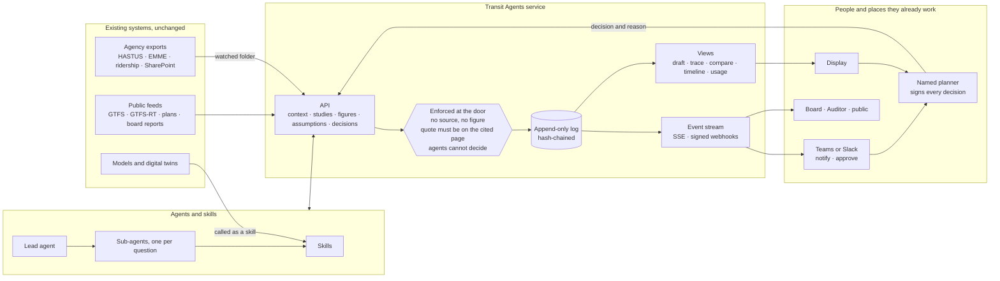

# System

Transit Agents is a service. Agents, planners, existing agency systems and the
display are all clients of it. Nothing it does requires replacing a system the
agency already runs.

## Rules the design follows

1. **The log is the only source of truth.** Every write is one log entry. Drafts,
   dashboards, webhooks and the display are all read from it, so they cannot
   disagree with it.
2. **Guarantees are enforced by the API, not by prompts.** A figure with no
   source is rejected. A cited figure is rejected if its quote is not on the
   cited page, or if its value is not in the quote. An agent token cannot record
   a decision.
3. **People decide.** Agents draft and check. A named planner signs. When a
   decision goes against the analysis, it is recorded as an override, with a reason.
4. **Existing systems stay.** Data arrives through exports they already produce.
   Decisions leave as webhooks. Nothing is migrated.
5. **Two clocks, never mixed.** The log always uses real time. The display's
   time control is a view of forecasts and schedules, and it writes nothing.

## API

Full schema at `GET /openapi.json`.

| To | Call |
|---|---|
| Add context | `POST /v1/context`, or drop a file in the watched folder |
| Open a study | `POST /v1/studies` |
| Report agent activity, tokens and cost | `POST /v1/studies/{id}/activity` |
| Add a figure | `POST /v1/studies/{id}/figures` |
| Test a figure against a rule | `POST /v1/studies/{id}/checks` |
| Set or change an assumption | `PUT /v1/assumptions/{key}` |
| Try a change without recording it | `POST /v1/studies/{id}/preview` |
| Record a decision (planners only) | `POST /v1/studies/{id}/decisions` |
| Read a study | `GET /v1/studies/{id}` |
| Trace a figure to its source | `GET /v1/figures/{id}/trace` |
| See what changed between versions | `GET /v1/studies/{id}/compare` |
| See results over time | `GET /v1/studies/{id}/timeline` |
| Read or verify the log | `GET /v1/log`, `GET /v1/log/verify` |
| See tokens and cost | `GET /v1/usage` |
| Stream everything live | `GET /v1/events` |
| Be told about decisions | `POST /v1/subscriptions` |

## Who may do what

| Role | Reads | Adds context | Adds figures | Changes assumptions | Decides |
|---|---|---|---|---|---|
| Viewer | Yes | | | | |
| Integration | Yes | Yes | | | |
| Agent | Yes | Yes | Yes | | |
| Planner | Yes | Yes | Yes | Yes | Yes |
